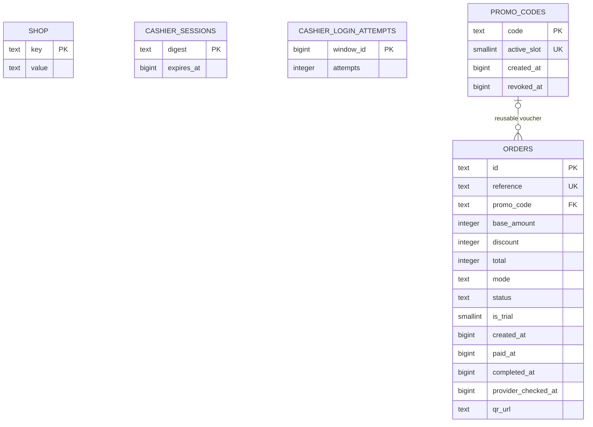

# PhotoBox database model

This is the PostgreSQL design for the first Neon deployment. Production and Sandbox deployments use separate databases or branches. Local preview uses its own SQLite database.

| Relationship or rule | Database guarantee |
| --- | --- |
| Order to reusable promo | `orders.promo_code` references `promo_codes.code`. An order can reference one discount code. Deactivation retains the promo row and all order history. |
| Five active promos | An active promo occupies one unique slot numbered 1 through 5. A revoked promo frees its slot and retains its own code as its permanent PK. |
| Checkout amounts | Whole rupiah integers. A discount is either zero or Rp5,000 and `total = base_amount - discount`. An order stores the values quoted at creation. |
| Midtrans identity | The merchant reference is unique. Only a matching Midtrans settlement can move a new order to paid. Historical trial rows retain their original status for reporting. |
| Admin access | Credentials are backend environment values. PostgreSQL stores session digests, expiry, and the login attempt counter. These records have no user FK because no user credential table exists. |
| Photo delivery | Order data contains no image bytes or recipient address. Email attachment delivery can process image bytes in memory independently of this schema. |

The [initial migration](../apps/api/postgres/0001_initial.sql) and [voucher cleanup migration](../apps/api/postgres/0002_remove_legacy_vouchers.sql) build this schema in order. Run both on a fresh Neon branch. Apply only the cleanup migration to an existing branch that already has the initial schema and has no legacy voucher records.
